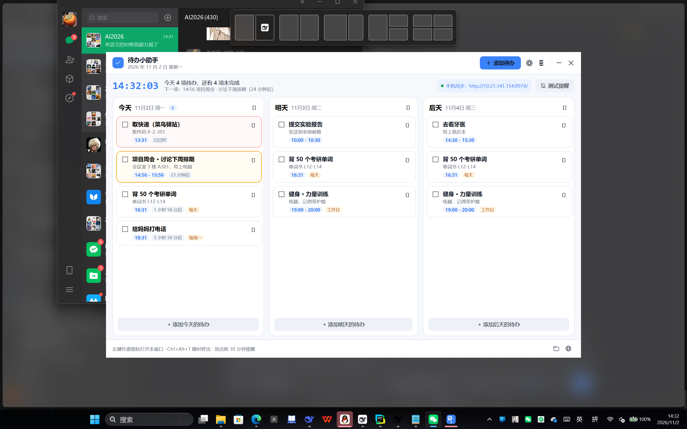
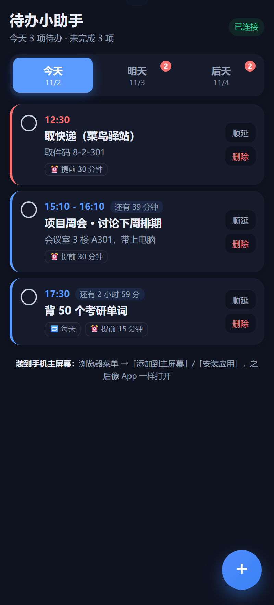

# DailyMessages · 待办小助手

一个常驻 Windows 托盘的轻量待办程序：**5 天视图 + 定时提醒 + DDL 截止时间 + 大日历 + 课程表式时间表 + 手机同步**。

单文件 exe，绿色免安装，双击即用。

> 界面预览见下方截图章节。

---

## 功能一览

### 桌面端

| 功能 | 说明 |
|---|---|
| **托盘常驻** | 左键托盘图标打开主窗口，右键菜单可快速添加 / 测试提醒 / 设置 / 退出。托盘图标会显示当天日期，有提醒时变红。 |
| **5 天视图** | 今天 / 明天 / 后天 / 大后天 / 5 天后，五列并排，卡片式展示。 |
| **定时提醒** | 距开始还剩 N 分钟（默认 30）时，弹出 Windows 通知 + 系统响铃 + 可选语音朗读。 |
| **DDL 截止时间** | 每条待办可单独设置截止时间，支持逐条提前提醒，以及**每天早 9:00 / 晚 21:00 的汇总提醒**（时间可改）。 |
| **大日历** | 按月查看，可切换年月，**重点红色标记所有 DDL**，右侧列出当月 DDL 清单。 |
| **时间表视图** | 每列可一键切成课程表样式：左侧时间轴，右侧按起止时间铺色块，**重叠任务自动并排**。 |
| **深色模式** | 浅色 / 深色 / 跟随系统，一键切换，实时生效不用重启。 |
| **重复待办** | 每天 / 工作日 / 每周同一天 / 每月同一天。 |
| **其他** | 全局快捷键 `Ctrl+Alt+T`、单实例、开机自启、数据原子写盘 + 备份、日志、自检命令。 |

### 手机端

- 内置局域网 HTTP 服务器，手机浏览器打开即用，**无需连公网**
- PIN + HttpOnly Cookie 鉴权
- PWA 可「添加到主屏幕」，像 App 一样打开
- **列表 / 时间表双视图**，与电脑端一致
- 可勾选完成、顺延、删除、新增
- 可选 ntfy 离线推送

---

## 快速开始

### 1. 构建

需要 **.NET 10 SDK**（Windows）。

```powershell
powershell -ExecutionPolicy Bypass -File .\构建.ps1
```

或手动发布单文件：

```powershell
cd src
dotnet publish -c Release -r win-x64 --self-contained true `
  -p:PublishSingleFile=true -p:IncludeNativeLibrariesForSelfExtract=true `
  -p:EnableCompressionInSingleFile=true -p:DebugType=none -o ..\release
```

产物是 `release\TodoAssistant.exe`（约 68 MB，自包含，目标机无需装 .NET）。

### 2. 安装

双击 `安装.bat`，它会：
- 结束正在运行的旧实例
- 复制到 `%LOCALAPPDATA%\TodoAssistant\`
- 创建开始菜单快捷方式（Windows 通知需要）
- 设置开机自启
- 启动程序

### 3. 使用

- **左键**托盘图标 → 打开主窗口
- **`Ctrl+Alt+T`** → 随时呼出
- **右键**托盘图标 → 菜单

---

## 界面预览

### 电脑端主界面（浅色）



### 手机端



---

## 时间表视图

每列顶部（日期右侧）有 **「时间表」** 按钮，点一下切换到课程表模式：

- 左侧 `06:00 - 24:00` 时间轴，带 `:30` 小刻度
- 任务按开始 / 结束时间画成对应高度的彩色块
- **时间重叠的任务自动左右并排**，不会互相遮挡
- 打开时自动滚到当前时间，并有一条红色「当前时间」线
- 点色块直接打开编辑
- 再点一次（按钮变为「卡片」）切回列表

## 大日历

主界面右上角 **📅** 按钮打开：

- `« ‹ › »` 切换年 / 月，「回到今天」
- 有 DDL 的日期用**红色底 + DDL 角标**标出，过期的红色更重
- 右侧列出当月全部 DDL，含剩余时间，点一条直接跳到编辑
- 点某一天可在那天新建待办
- 窗口可拖拽、可调整大小、双击标题栏最大化

## DDL 截止时间

在添加 / 编辑待办时勾选 **「设置 DDL（截止时间）」**：

- 选截止日期和时间（默认当天 23:59）
- 可选「DDL 单独提醒」：提前 1 小时 / 3 小时 / 12 小时 / 1 天 / 2 天
- **每天早 9:00、晚 21:00 自动汇总提醒**（可在设置里改时间、开关、提前天数）

汇总规则：
- 已过期的、今天到期的**始终包含**
- 其余在设定天数内（默认 7 天）的也包含

## 深色模式

右上角 **🌙 / ☀️** 按钮一键切换；也可在「设置 → 外观 → 主题」选 **跟随系统 / 浅色 / 深色**。

深色样式覆盖主窗口、编辑对话框、设置窗口、托盘菜单、滚动条。

---

## 手机同步

1. 电脑端右键托盘 →「手机同步 / 推送设置」
2. 打开开关，窗口里会显示地址（形如 `http://192.168.x.x:8974`）和二维码
3. 手机连同一 WiFi，扫码或输入地址
4. 输入 PIN（在同一窗口里可查看 / 修改）
5. 浏览器菜单 →「添加到主屏幕」，即可像 App 一样使用

### 可选：ntfy 离线推送

即使手机没打开页面，也能收到提醒：

1. 手机安装 [ntfy](https://ntfy.sh/) App，订阅一个随机主题名
2. 电脑端在手机设置里填相同主题
3. 提醒触发时电脑会 POST 到 ntfy，手机收到推送

> 默认用公共 ntfy.sh 服务器，内容会经过第三方，敏感内容建议自建服务器。

---

## 提醒规则

| 触发时机 | 行为 |
|---|---|
| 距开始还剩 `leadMinutes`（默认 30 分钟） | Toast 通知 + 响铃 + 可选语音 |
| 到点（可选开启） | 再提醒一次 |
| 程序启动时 | 补发错过的提醒（**夜间 0–8 点不补发**） |
| DDL 汇总时间（默认 9:00 / 21:00） | 汇总所有到期的 DDL |
| DDL 单独提醒 | 按每条设置的提前量 |

去重策略：两类提醒各有**落盘标记 + 内存键**（`id|date|kind`），修改时间会自动重置，重启不会重复提醒。

---

## 数据位置

```
%LOCALAPPDATA%\TodoAssistant\
├─ todos.json      # 待办数据（原子写盘，自动保留 .bak 备份）
├─ settings.json   # 设置
└─ app.log         # 日志
```

调试时可把数据目录指到别处：

```powershell
$env:TODOASSISTANT_DATA = "D:\test-data"
```

---

## 命令行

```powershell
TodoAssistant.exe --selfcheck          # 自检：存储 / 通知 / 响铃 / 手机服务器 / 二维码
TodoAssistant.exe --repair             # 重新注册 Windows 通知
TodoAssistant.exe --uninstall-startup  # 取消开机自启
TodoAssistant.exe --autostart          # 静默启动（开机自启用）
TodoAssistant.exe --log                # 查看日志路径
```

---

## 目录结构

```
DailyMessages/
├─ 构建.ps1                       # 一键构建单文件 exe
├─ 安装.bat / 卸载.bat / 自检.bat
├─ 使用说明.md                    # 面向普通用户的说明
├─ assets/app.ico                 # 程序图标
└─ src/
   ├─ TodoAssistant.csproj        # net10.0-windows10.0.26100.0, WPF, 单文件自包含
   ├─ app.manifest                # asInvoker + PerMonitorV2 DPI
   ├─ App.xaml(.cs)               # 资源宿主 + 总控（托盘、提醒分发、手机服务）
   ├─ Program.cs                  # 入口：单实例、命令行
   ├─ Models/
   │   ├─ TodoItem.cs             # 待办含重复展开、DDL 计算
   │   └─ AppSettings.cs          # 设置（含主题、DDL 汇总配置）
   ├─ Services/
   │   ├─ TodoStore.cs            # 内存 + 原子写盘
   │   ├─ SettingsStore.cs
   │   ├─ ReminderScheduler.cs    # 10 秒轮询扫描
   │   ├─ DeadlineService.cs      # DDL 汇总 / 单条提醒
   │   ├─ ThemeManager.cs         # 浅色 / 深色 / 跟随系统
   │   ├─ Notifier.cs             # Toast 通知 + 托盘气泡兜底
   │   ├─ Alarm.cs                # MessageBeep + SAPI 朗读
   │   ├─ PhoneServer.cs          # 手机 REST API + 内嵌网页 + PIN 会话
   │   ├─ HttpServer.cs           # 自写极简 HTTP/1.1（TcpListener）
   │   ├─ PhoneNotifier.cs        # ntfy 推送
   │   ├─ HotkeyManager.cs        # 全局热键
   │   ├─ ShortcutHelper.cs       # 快捷方式 / AUMID
   │   ├─ QrCode.cs               # 自写二维码生成
   │   └─ Log.cs
   ├─ ViewModels/                 # 列 / 行 / 编辑对话框 VM
   ├─ Views/
   │   ├─ MainWindow.xaml(.cs)
   │   ├─ DayColumnFactory.cs     # 动态生成 5 列
   │   └─ Dialogs/                # 编辑、设置、手机同步、DDL 列表、大日历
   ├─ Controls/
   │   ├─ TrayIconFactory.cs      # 代码绘制托盘图标
   │   ├─ WheelTimePicker.cs      # 步进式时间选择器
   │   ├─ DateDropDown.cs
   │   └─ DayScheduleView.cs      # 时间表视图（时间轴 + 任务块 + 重叠并排）
   ├─ Converters/
   ├─ Themes/                     # Theme.xaml（样式）+ Colors.Light/Dark.xaml
   └─ Services/Web/               # 手机网页（以嵌入资源打包）
      ├─ index.html / app.js / style.css
      ├─ manifest.webmanifest / sw.js
      └─ assets/
```

---

## 关键设计说明

- **HTTP 不用 `HttpListener`**：`http://+:端口` 需要管理员登记 http.sys 前缀，普通用户启动会 `Access is denied`。
  改用 `TcpListener` + 自写解析，普通权限即可监听 `0.0.0.0`。
- **手机网页状态只存内存**：现代浏览器在 `http://局域网IP` 下可能禁用 localStorage / sessionStorage，
  所以手机端状态全部放内存，登录态靠服务器签发的 HttpOnly Cookie。
- **主题切换用资源覆盖**：不替换 `ResourceDictionary`（已编译进 BAML 的引用不会更新），
  而是直接改写 `Application.Resources` 里每个颜色键的画刷值，界面全部用 `DynamicResource` 引用，
  切换即时生效。
- **图标全部矢量图形**：早期用 `Segoe Fluent Icons` 字体码位，部分 Windows 版本缺字形会显示成方块，
  已全部改为 XAML `Path` 或 emoji。
- **手机端禁缓存**：Service Worker 只缓存图标，`app.js` / `style.css` / `index.html` 强制走网络；
  服务器对 `.js` / `.css` / `.html` 返回 `no-cache`，避免更新后手机拿到旧文件。
- **重复待办**：每天实例由主记录 `Expand()` 生成；编辑时以**主记录**为基准合并改动，
  避免把展开日的日期写回主记录（会导致重复出条目）。

---

## 系统要求

- **运行**：Windows 10 / 11（x64）
- **构建**：.NET 10 SDK

---

## 开源说明

本项目为个人自用工具，代码公开仅供参考与交流。欢迎提 Issue 交流。

> 注：仓库内的 exe 发布产物未纳入版本管理（体积较大），请用 `构建.ps1` 自行构建。
